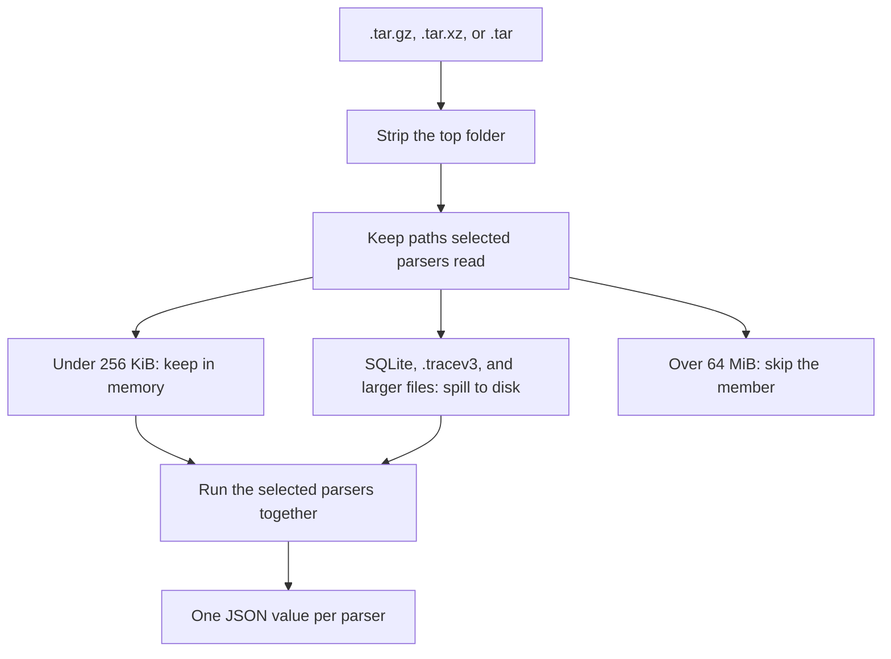
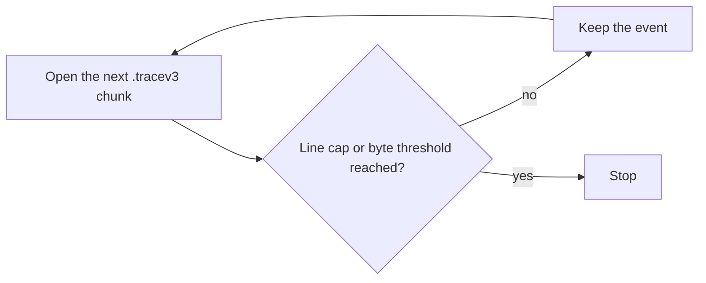

# sysdiagnose-extractor-library

Rust library and `sdx-cli` for Apple sysdiagnose archives (`.tar.gz`, `.tar.xz`, or `.tar`). This crate parses only. Analysers and Sigma rules belong in other projects.

```
cargo test --offline
cargo build --release --bin sdx-cli
```

The archive’s top folder is stripped, so `sysdiagnose_2024…/ps.txt` is read as `ps.txt`. Members larger than 64 MiB are skipped. Files under 256 KiB stay in memory. SQLite databases, every `.tracev3`, and anything else at or above 256 KiB are spilled to a temp directory. `.tracev3` files under `system_logs.logarchive/` are spilled and decoded from that directory. A nested sysdiagnose archive is expanded one level.



Passing `--parsers ps,sys` builds the keep-list from those parsers only. `apollo_all` and `plists` match broadly, so selecting either one retains the whole archive.

## Command line

```
./target/release/sdx-cli --list-parsers
./target/release/sdx-cli ARCHIVE
./target/release/sdx-cli ARCHIVE --parsers ps,sys --show-parser-results
./target/release/sdx-cli ARCHIVE --jsonl-out ./out
./target/release/sdx-cli ARCHIVE --logarchive-inventory-only
./target/release/sdx-cli ARCHIVE --ioservice-full-tree
```

Without `--show-parser-results` each line is the parser id, whether it succeeded, and the duration. JSON is not printed:

```
ps	true	0ms
sys	true	0ms
```

`--show-parser-results` prints one object. Keys are parser ids. Each value is `ok`, `duration_ms`, and `data` or `error`. This is the output of `sdx-cli --parsers ps,sys --show-parser-results` on an archive that contains only the files below.

`ps.txt`:

```
USER UID PID PPID %CPU %MEM PRI NI VSZ RSS WCHAN TT STAT STARTED TIME COMMAND
root 0 1 0 0.0 0.1 31 0 1234 567 - ?? Ss 12:00AM 0:01.00 /sbin/launchd
mobile 501 45 1 1.2 0.4 31 0 2345 890 - ?? S 12:01AM 0:02.00 /usr/libexec/mobileassetd
```

`logs/SystemVersion/SystemVersion.plist` with `ProductName` `iPhone OS`, `ProductVersion` `17.0`, `ProductBuildVersion` `21A329`.

```json
{
  "ps": {
    "ok": true,
    "duration_ms": 0,
    "data": {
      "parser": "ps",
      "source": "ps.txt",
      "rows": [
        {
          "user": "root",
          "uid": 0,
          "pid": 1,
          "ppid": 0,
          "command": "/sbin/launchd",
          "process_name": "launchd"
        },
        {
          "user": "mobile",
          "uid": 501,
          "pid": 45,
          "ppid": 1,
          "command": "/usr/libexec/mobileassetd",
          "process_name": "mobileassetd"
        }
      ]
    }
  },
  "sys": {
    "ok": true,
    "duration_ms": 0,
    "data": {
      "parser": "sys",
      "source": "logs/SystemVersion/SystemVersion.plist",
      "message": "SystemVersion iPhone OS 17.0 21A329",
      "plist": {
        "ProductName": "iPhone OS",
        "ProductVersion": "17.0",
        "ProductBuildVersion": "21A329"
      }
    }
  }
}
```

The real `ps` rows also include `%cpu`, `%mem`, `rss`, `vsz`, `stat`, `time`, `started`, and `command_line`. `--jsonl-out` writes `out/<parser>.jsonl`, one event per line, for parsers whose JSON has an `events` array. Those events carry `message`, `datetime`, `timestamp_desc`, and `module`.

`--mem-budget` and `--spill-dir` change retention. `--profile low` lowers the inline limit to 64 KiB and the budget to 64 MiB. `--profile max` raises the inline limit to 8 MiB. `--stats` prints byte counters on stderr.

## Unified log

`logarchive` inventories `system_logs.logarchive/` and, when the `logarchive-decode` feature is on, decodes `.tracev3` with `mul-unifiedlog`. Decoding stops at the line cap. The default is 2,500 events. `--logarchive-decode-max-lines 0` means 250,000, the same ceiling as the other CLI. `SYSDIAGNOSE_LOGARCHIVE_DECODE_MAX_LINES` overrides the default.

`--logarchive-memory-threshold BYTES` stops the decode once the retained events reach that size. The limit is off unless you pass the flag or set `SYSDIAGNOSE_LOGARCHIVE_MEMORY_THRESHOLD`. A threshold of `0` also leaves it off.

```
./target/release/sdx-cli ARCHIVE --logarchive-decode-max-lines 0
./target/release/sdx-cli ARCHIVE --logarchive-memory-threshold 268435456
```



The byte check is skipped when the threshold is off. `scripts/bench.sh` runs both CLIs with `--logarchive-decode-max-lines 0` and leaves the byte threshold off. On the 255 MiB archive both sides kept 250,000 events. Warm runs were about 2.3 s and 2.7 GiB here, and about 3.9–4.0 s and 2.8 GiB upstream.

## Parsers

There are 67. `--list-parsers` prints the same ids and descriptions. The SQLite parsers run the modules embedded in `mul-apollo`. The crate is GPL-3.0-only.

| parser | reads | description |
| --- | --- | --- |
| `accessibility_tcc` | `logs/Accessibility/TCC.db` | Parsing Accessibility TCC logs |
| `apollo_all` | every file | Run all bundled APOLLO modules on discovered SQLite DBs |
| `appinstallation` | `logs/appinstallation/AppUpdates.sqlitedb`, `logs/appinstallation/appstored.sqlitedb` | Parsing app installation logs |
| `avconference_callsettings` | `logs/AVConference/*-CallSettings.calldump.gz` | Parsing AVConference CallSettings calldump files |
| `awd_baseband` | `logs/AWD/**`, `logs/Baseband/**`, `**/*.metriclog`, `**/*.istp` | Inventory of AWD metriclog / baseband binary traces |
| `battery_bdc` | `logs/BatteryBDC/*.csv` | Parsing BatteryBDC CSV files |
| `bluetooth` | `WiFi/bluetooth_status.txt`, `WiFi/awdl_status.txt`, `logs/Bluetooth/**`, `logs/NetworkRelay/companion_link_status*.txt` | Bluetooth / AWDL / companion-link status text |
| `brctl` | `brctl/brctl-container-list.txt`, `brctl/brctl-dump.txt` | Parsing brctl files |
| `ckks_pcs` | `ckksctl_status.txt`, `pcsstatus.txt` | CloudKit Key Sync and Protected Cloud Storage status |
| `collection_meta` | `taskSummary.csv`, `errors/*.txt`, `summaries/*.log`, `sysdiagnose.log` | taskSummary / errors / summaries / sysdiagnose.log collection meta |
| `containermanager` | `logs/MobileContainerManager/containermanagerd.log*` | Parsing containermanagerd logs file |
| `crashlogs` | `**/crashes_and_spins/**/*.ips`, `**/summaries/crashes_and_spins.log`, `**/CrashReporter/**/*.ips` | Parsing crashes folder |
| `disks` | `disks.txt` | Parsing disks.txt file (df output) |
| `ioacpiplane` | `ioreg/IOACPIPlane.txt` | IOACPIPlane.txt file parser |
| `iodevicetree` | `ioreg/IODeviceTree.txt` | IODeviceTree.txt file parser |
| `iofirewire` | `ioreg/IOFireWire.txt` | IOFireWire.txt file parser |
| `iopower` | `ioreg/IOPower.txt` | IOPower.txt file parser |
| `ioservice` | `ioreg/IOService.txt` | IOService.txt file parser |
| `iousb` | `ioreg/IOUSB.txt` | IOUSB.txt file parser |
| `interactionc` | `**/interactionC.db` | Parsing interactionC.db (APOLLO) |
| `ioport` | `ioreg/IOPort.txt` | IOPort.txt file parser (IOReg) |
| `itunesstore` | `logs/itunesstored/downloads.*.sqlitedb` | Parsing iTunes store logs |
| `kbdebug` | `kbdebug.txt` | kbdebug.txt logfile parser |
| `knowledgec` | `**/Knowledge/knowledgeC.db`, `**/CoreDuet/Knowledge/knowledgeC.db` | Parsing KnowledgeC database (APOLLO) |
| `lockdownd` | `logs/MobileLockdown/lockdownd.log*` | Parsing lockdownd logs file |
| `logarchive` | `system_logs.logarchive/**` | Parsing system_logs.logarchive folder |
| `logdata_statistics` | `system_logs.logarchive/Extra/logdata.statistics.*.jsonl` | Parsing logdata.statistics.jsonl files |
| `logdata_statistics_txt` | `system_logs.logarchive/Extra/logdata.statistics.*.txt` | Parsing logdata.statistics.txt files |
| `lsaw` | `**/lsaw.csstoredump` | LaunchServices lsaw.csstoredump (string scrape) |
| `mcsettingsevents` | `logs/MCState/Shared/MCSettingsEvents.plist` | Parsing MC Settings Events plist file |
| `mcstate_shared_profile` | `logs/MCState/Shared/profile-*.stub` | Parsing MCState Shared Profile stub files |
| `microstackshots` | `**/microstackshots` | microstackshots process-sampling history (gzip inventory) |
| `mobileactivation` | `logs/MobileActivation/mobileactivationd.log*` | Parsing mobileactivation logs file |
| `mobilebackup` | `logs/MobileBackup/com.apple.MobileBackup.plist` | Parsing mobilebackup plist file |
| `mobileinstallation` | `logs/MobileInstallation/mobile_installation*.log*` | Parsing mobile_installation logs file |
| `mount` | `mount.txt` | Parsing mount.txt (sealed / read-only root integrity) |
| `networkextension` | `logs/Networking/com.apple.networkextension.plist` | Parsing networkextension plist file |
| `networkextensioncache` | `logs/Networking/com.apple.networkextension.cache.plist` | Parsing networkextensioncache plist file |
| `netusage` | `**/netusage.sqlite` | Parsing netusage.sqlite (APOLLO) |
| `olddsc` | `logs/olddsc/**` | Parsing olddsc (Dynamic Shared Cache) files |
| `ota_update` | `logs/OTAUpdateLogs/**`, `restore_perform.txt` | OTA / restore logs under logs/OTAUpdateLogs |
| `plists` | `**/*.plist` | Parsing any pslist into json |
| `powerlogs` | `logs/powerlogs/powerlog_*`, `logs/powerlogs/log_*`, `**/CurrentPowerlog.PLSQL` | Parsing powerlogs database |
| `preferences` | `Preferences/*.txt` | Preferences/*.txt locale / Screen Time / accessibility dumps |
| `ps` | `ps.txt` | Parsing ps.txt file |
| `psthread` | `ps_thread.txt` | Parsing ps_thread.txt file |
| `quarantine_events` | `**/com.apple.LaunchServices.QuarantineEventsV2` | Parsing Launch Services quarantine DB (APOLLO) |
| `remotectl_dumpstate` | `remotectl_dumpstate.txt` | Parsing remotectl_dumpstate file containing system information |
| `runningboard` | `RunningBoard/RunningBoard_state.log` | RunningBoard_state.log process assertions |
| `safari_history` | `**/Safari/History.db` | Parsing Safari History.db (APOLLO) |
| `security_sysdiagnose` | `security-sysdiagnose.txt` | Parsing security-sysdiagnose.txt file containing keychain information |
| `screentime` | `**/RMAdminStore-Local.sqlite`, `**/RMAdminStore-Cloud.sqlite` | Parsing Screen Time RMAdminStore databases (APOLLO) |
| `shutdownlogs` | `system_logs.logarchive/Extra/shutdown.log`, `private/var/db/diagnostics/shutdown.log` | Parsing shutdown.log file |
| `spindumpnosymbols` | `**/spindump-nosymbols.txt` | Parsing spindump-nosymbols file |
| `swcutil` | `**/swcutil_show.txt` | Parsing swcutil_show file |
| `sys` | `logs/SystemVersion/SystemVersion.plist` | Parsing SystemVersion plist file |
| `system_stats` | `apfs_stats.txt`, `vm_stat.txt`, `zprint.txt`, `smcDiagnose.txt`, `logs/Trial/trial.log`, `logs/suggest_tool/**` | APFS / VM / SMC / Trial / suggest_tool system stats text |
| `taskinfo` | `taskinfo.txt` | Parsing taskinfo txt file |
| `transparency` | `transparency.log` | Parsing transparency.log json file as timeline |
| `transparency_json` | `transparency.log` | Parsing transparency.log json file as json |
| `usermanagement` | `logs/UserManagement/umtool.txt`, `**/usermanagerd.log*` | umtool / usermanagerd user accounts and personas |
| `uuid2path` | `logs/tailspindb/UUIDToBinaryLocations*` | Parsing UUIDToBinaryLocations plist file |
| `wifi_diagnostics` | `WiFi/ifconfig.txt`, `WiFi/arp.txt`, `WiFi/netstat-PRE.txt`, `WiFi/netstat-POST.txt`, `WiFi/wifi_status.txt`, `WiFi/diagnostics-*.txt` | WiFi ifconfig / arp / netstat / status / diagnostics text |
| `wifi_known_networks` | `WiFi/com.apple.wifi.known-networks.plist` | Parsing Known Wifi Networks plist file |
| `wifinetworks` | `WiFi/*.plist`, `WiFi/com.apple.wifi.recent-networks.json` | Parsing com.apple.wifi plist files |
| `wifiscan` | `WiFi/wifi_scan*.txt` | Parsing wifi_scan files |
| `wifisecurity` | `WiFi/security.txt` | Parsing WiFi Security logs |

## Python

The extension is `python/`. It imports as `sysdiagnose_extractor` and calls the same archive plan and parsers as `sdx-cli`, including unified-log decode and the APOLLO SQLite modules.

```
cd python
python3 -m venv .venv
source .venv/bin/activate
pip install maturin
maturin develop --release
```

```python
import sysdiagnose_extractor

print(len(sysdiagnose_extractor.list_parsers()))  # 67

result = sysdiagnose_extractor.parse(
    "/path/to/sysdiagnose.tar.gz",
    parsers=["ps", "sys"],
)

ps = result["ps"]
assert ps["ok"]
for row in ps["data"]["rows"]:
    print(row["pid"], row["command"])

print(result["sys"]["data"]["message"])
print(result["sys"]["data"]["plist"]["ProductBuildVersion"])
```

On the archive above that prints:

```
1 /sbin/launchd
45 /usr/libexec/mobileassetd
SystemVersion iPhone OS 17.0 21A329
21A329
```

`parse` returns a dict keyed by parser id. Each value has `ok`, `ms`, and either `data` or `error`. Omit `parsers` to run all 67. An unknown name raises `ValueError`. A missing path raises `OSError`.

`logarchive_max_lines` and `logarchive_memory_threshold` match the CLI flags. Leave `logarchive_memory_threshold` unset to keep the byte limit off.

```python
sysdiagnose_extractor.parse(
    "/path/to/sysdiagnose.tar.gz",
    logarchive_max_lines=0,
    logarchive_memory_threshold=256 * 1024 * 1024,
)
```
